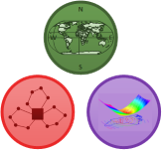
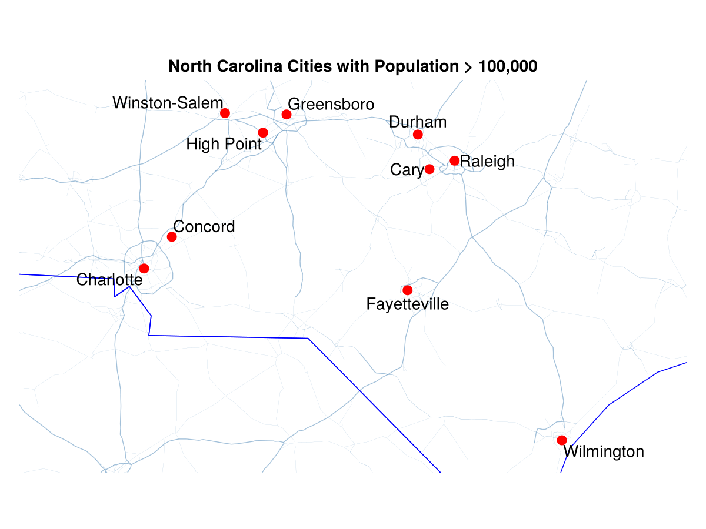
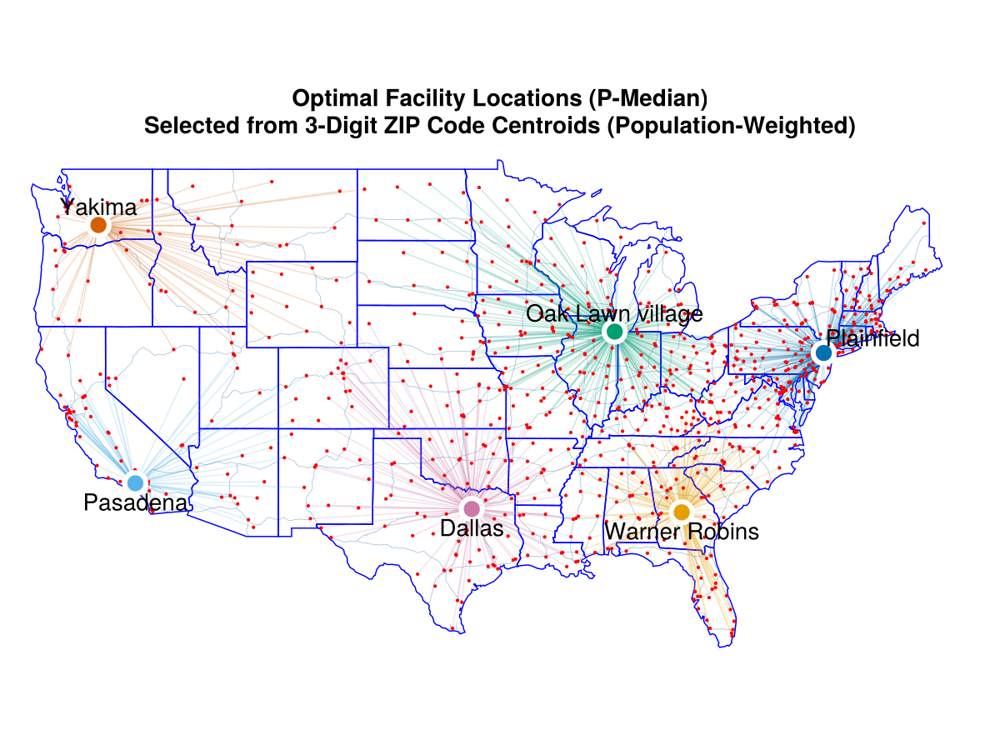
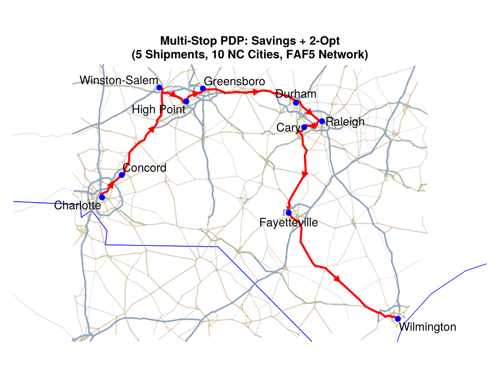
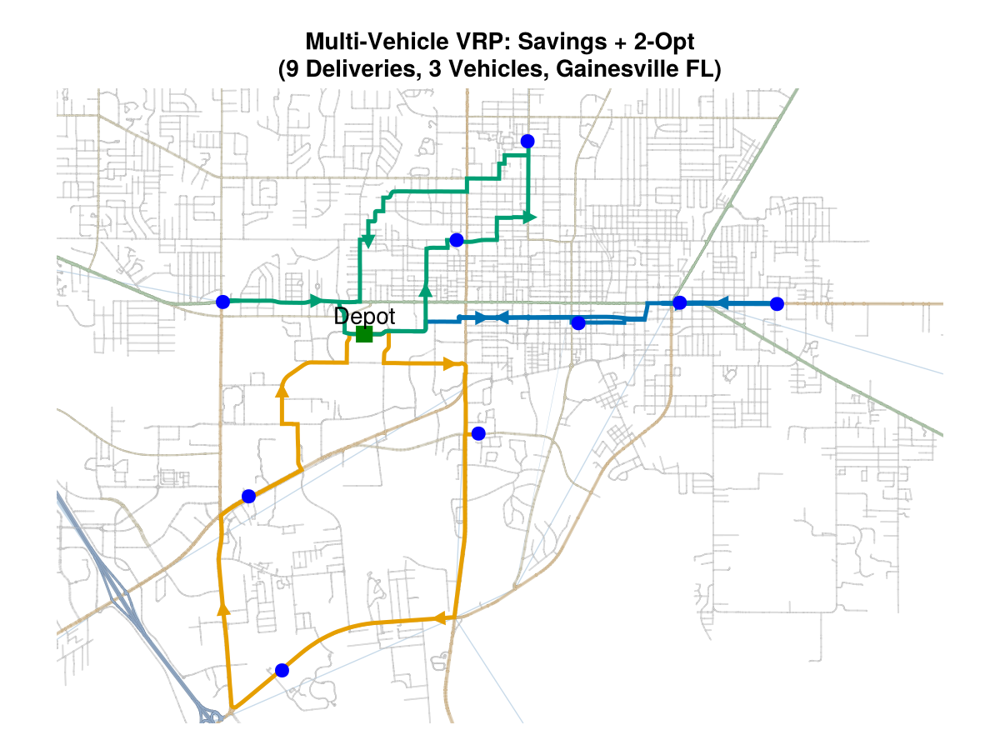

# Logjam



[](https://mgkay.github.io/Logjam/)

Logjam is a Julia package for logistics engineering, providing tools for:
* **Facility Location**: Discrete optimization algorithms for facility location problems, including Uncapacitated Facility Location (UFL) and *p*-Median construction and improvement heuristics, plus continuous location via alternating location–allocation (`ala`) and the weighted center of gravity (`wcentroid`).
* **Transportation Costing**: Formulas for estimating LTL & TL freight rates, calculating minimum charges, and evaluating total logistics costs (TLC).
* **Network Analysis**: Routing and topology tools for the FAF5 highway network, including shortest paths and automatic facility connectors.
* **Vehicle Routing**: Algorithms for multi-stop route optimization, featuring savings-based construction and local search improvement methods.
* **Spatial Data**: A gazetteer of U.S. administrative boundaries and points, including Cities, Counties, ZIP codes (3- and 5-digit), Census tracts, and CBSA/CSA definitions.
* **Geocoding**: Forward (`loc2lonlat`) and reverse (`lonlat2loc`) geocoding with tiered resolution — street addresses via Nominatim, city/place names, postal codes, and counties from built-in reference data.
* **Distance Metrics**: Unified distance calculation utilities supporting Rectilinear (*L*₁), Euclidean (*L*₂), Minkowski (*L_p*), Chebyshev (*L*∞), Great Circle (Haversine), and area-adjusted great-circle (`dgca`) metrics.
* **Plotting**: Plotting on any Makie axis, a plain `Axis` with CairoMakie alone or a map from `makemap`. Label placement (`aligntext(ax, x, y, labels)`) reads the figure as drawn and puts each label beside its point, clear of the lines, markers and other labels already in the axis. Route drawing (`plotroute!`) and shipment drawing (`plotshmt!`, Matlog's `plotshmt`) put an arrowhead on each leg, label each stop with its name and the shipments loaded and unloaded there (`ldlabel`), number several routes, and draw schematics in Matlog's numbered-node style: bowed curves cut at numbered nodes, with labels along the curves.
* **Mapping**: Plotting recipes and helper functions for mapping spatial data using GeoMakie.
* **Data Helpers**: Formatted printing (`prt`), thousands separators (`thousands`), floating-point snapping (`snapvals`), the 51-row state table (`usstate`), and a table's or a geocoded place's coordinates as the distance functions take them (`lonlat`).

## Installation

Requires Julia 1.12+ (due to GeoMakie 0.7).

To install Logjam, use the following command in your Julia REPL:

```julia
using Pkg
Pkg.add(url="https://github.com/mgkay/Logjam", rev="v0.3.0")
```

To run all examples in the README and the example notebook, install the additional packages:

```julia
Pkg.add(["CairoMakie", "GeoMakie", "HTTP", "JSON3", "LightOSM"])
```

## Dependencies

Logjam uses Julia package extensions to keep its core lightweight. Features activate automatically based on which packages are loaded:

| `using` statement | Features enabled |
|---|---|
| `using Logjam` | Core: facility location, costing, distances, road networks, routing, spatial data, geocoding, data helpers. |
| `using Logjam, CairoMakie` | + plotting on any Makie axis: `aligntext(ax, x, y, labels)`, which places labels clear of what is drawn, and route and shipment drawing, `plotroute!` and `plotshmt!`. CairoMakie loads Makie, which loads the Makie extension. |
| `using Logjam, CairoMakie, GeoMakie` | + the above, and mapping: `makemap` and `plotroads!`. GeoMakie loads the map extension; CairoMakie draws. |
| `using LightOSM; using Logjam` | + OSM roads: `osm_roads` (downloading; a saved copy reads without it). |
| `using HTTP, JSON3; using Logjam` | + address geocoding: `loc2lonlat` address tier via Nominatim. |
| `using JuMP, HiGHS; using Logjam` | + optimization models: `Logjam.TSP`, `Logjam.binpack`, and `snapvals` on a solved model's variables. JuMP and HiGHS together load the optimization extension. |

## Worked Examples

The examples below are ordered for incremental capability building — each one introduces a focused set of Logjam functions that later examples build upon. The full capability set is described in the overview bullets above. All examples are available as a runnable Jupyter notebook: [logjam_examples.ipynb](https://raw.githubusercontent.com/mgkay/Logjam/main/examples/logjam_examples.ipynb).

---

### Example 1 — Spatial Data

Logjam includes a built-in U.S. gazetteer covering cities (`usplace`), counties (`uscounty`), 3- and 5-digit ZIP codes (`uszcta3`, `uszcta5`), CBSAs (`uscbsa`), and CSAs (`uscsa`). All tables share a consistent schema: FIPS codes for joining, LON/LAT coordinates following the Logjam convention (longitude first), and population counts where available. This example demonstrates loading and filtering place data, FIPS code conversion, and geocoding.

```julia
using Logjam
using DataFrames

# Load U.S. place data (cities, towns, CDPs) and inspect the schema
places = usplace()
display(first(places[:, [:NAME, :ST, :LON, :LAT, :POP, :ISCUS]], 4))
```

```
4×6 DataFrame
 Row │ NAME            ST      LON       LAT      POP    ISCUS
     │ String          Symbol  Float64   Float64  Int64  Bool
─────┼─────────────────────────────────────────────────────────
   1 │ Albertville     AL      -86.2107  34.2631  22386   true
   2 │ Alexander City  AL      -85.9371  32.9272  14843   true
   3 │ Anniston        AL      -85.8109  33.6735  21564   true
   4 │ Auburn          AL      -85.4895  32.6077  76143   true
```

```julia
# FIPS conversion: state symbol ↔ FIPS code
fips_nc = st2fips(:NC)           # 37
fips2st(fips_nc)                 # :NC

# Filter to NC cities with population over 100,000
nc_large = filter(r -> r.STFIP == fips_nc && r.POP > 100_000, places)
println("$(nrow(nc_large)) NC cities with pop > 100k")

# Forward geocoding: city name to coordinates
geo = loc2lonlat("Raleigh", state=:NC)
println("Raleigh: ($(round(geo.LON; digits=2)), $(round(geo.LAT; digits=2))), source=$(geo.GC_SOURCE)")

# Reverse geocoding: coordinates to nearest named place
nearest = lonlat2loc([-78.85, 35.73], filter(r -> r.POP > 50_000 && r.ISCUS, places))
println("Nearest large city: $(nearest.desc)")

# Load continental US 3-digit ZIP centroids
z3 = filter(r -> r.ISCUS, uszcta3())
println("Continental US 3-digit ZIPs: $(nrow(z3))")
```

```
10 NC cities with pop > 100k
Raleigh: (-78.64, 35.83), source=PLACE
Nearest large city: in Apex, NC
Continental US 3-digit ZIPs: 882
```

**After-action.** The `ISCUS` flag is the standard filter for continental U.S. analysis — it removes Alaska, Hawaii, Puerto Rico, and other territories that would distort national maps. All coordinate columns follow the (LON, LAT) convention throughout Logjam, which means western longitudes are negative. The `st2fips` and `fips2st` functions enable joins between datasets that use different geographic identifiers. `loc2lonlat` provides forward geocoding — from place names, postal codes, or street addresses to coordinates — and returns source attribution and distance uncertainty along with each result. `lonlat2loc` is the reverse: given a coordinate, it finds the nearest named place and reports whether the point is "in" the place (using an area-based radius) or a distance and direction away; it is used in later examples to label facility hub coordinates with interpretable city names.

---

### Example 2 — Mapping

Logjam's `makemap` function creates GeoMakie map figures with automatic projection, region detection, and a road background drawn from FAF5 that shows more roads the smaller the map. This example maps NC cities and introduces the full mapping toolkit: `makemap` for the figure and axis, `scatter!` and `text!` for data, `aligntext` for automatic label positioning, and the `roads` keyword for customizing the built-in road overlay.

```julia
using Logjam
using CairoMakie, GeoMakie, DataFrames

# Load NC cities with population > 100,000
cities = filter(r -> r.STFIP == st2fips(:NC) && r.POP > 100_000, usplace())
x, y, name = cities.LON, cities.LAT, cities.NAME

# Create map — auto-fits region to data; draws the major roads by default
fig, ax = makemap(x, y; roads = (; color = :steelblue, alpha = 0.5))
ax.title = "North Carolina Cities with Population > 100,000"

# Plot city locations and labels
scatter!(ax, x, y, color=:red, markersize=12)
text!(ax, x, y, text=name; aligntext(x, y)...)

fig
```



**After-action.** `makemap` detects when coordinates fall within the continental U.S. and automatically overlays a road network as a geographic reference, chosen by the map's size: FAF5's roads on a map 150 miles across or less, the major roads of Logjam's U.S. road network (`usrdlink`, derived from FAF5) on a state or a region such as this one, and its Interstates on a larger map. The `roads` keyword restyles that road overlay directly (`color`, `alpha` and `linewidth`), as shown above where the roads are drawn in semi-transparent steel blue. `aligntext(x, y)` returns a named tuple of keyword arguments (`:align`, `:offset`) that are splatted into `text!` via `...`, automatically positioning each label to avoid overlap with its marker.

---

### Example 3 — Facility Location

A classic strategic logistics problem: place a fixed number of distribution hubs to minimize total weighted distance to customers. Using U.S. 3-digit ZIP code centroids as demand points and population as demand weight, the *p*-median model selects six hubs that minimize total people-miles. This example introduces `dists` for distance matrix construction, `pmedian`, `alloclines`, and `lonlat2loc` for the full facility location workflow, and `prt` for formatted matrix display.

```julia
using Logjam
using CairoMakie, GeoMakie, DataFrames

# Load continental US 3-digit ZIP code centroids
z3 = filter(r -> r.ISCUS, uszcta3())
XY = hcat(z3.LON, z3.LAT)

# Build population-weighted cost matrix: C[i,j] = distance(i,j) × population(j)
C = dists(XY, XY, :mi) .* z3.POP'

# Solve p-median: select 6 hubs minimizing total people-miles
y, TC, W = pmedian(6, C; verbose=false)

# Reverse-geocode hub coordinates to nearest large city
hubs = lonlat2loc(XY[y, :], filter(r -> r.POP >= 50_000 && r.ISCUS, usplace()))

# Display hub locations (prt auto-formats coordinates)
prt(XY[y, :]; rows=hubs.NAME, cols=["LON", "LAT"], row_title="Hubs")
```

```
            Hubs      LON    LAT
────────────────────────────────
      Plainfield   -74.48  40.75
   Warner Robins   -83.48  32.64
Oak Lawn village   -87.73  41.77
          Dallas   -96.79  32.81
        Pasadena  -118.11  34.18
          Yakima  -120.45  46.62
```

```julia
# Map: continental US with allocation lines and hub markers
fig, ax = makemap(region=:CUS)

colors = Makie.wong_colors()[1:6]
X, Y = alloclines(W, XY, XY)
for (ci, i) in enumerate(y)
    lines!(ax, X[i], Y[i], color=(colors[ci], 0.2), linewidth=0.8)
end

scatter!(ax, XY[:, 1], XY[:, 2], color=:red, markersize=3, strokewidth=0)
hub_xy = XY[y, :]
scatter!(ax, hub_xy[:, 1], hub_xy[:, 2], color=colors, markersize=18,
         strokewidth=3, strokecolor=:white)
text!(ax, hub_xy[:, 1], hub_xy[:, 2], text=hubs.NAME; aligntext(hub_xy[:, 1], hub_xy[:, 2])...)

ax.title = "Optimal Facility Locations (P-Median)\nSelected from 3-Digit ZIP Code Centroids (Population-Weighted)"
fig
```



**After-action.** `dists(XY, XY, :mi)` computes a full pairwise great-circle distance matrix in miles; the `:mi` symbol selects miles, `:km` selects kilometers, and `:rad` returns dimensionless radians. Broadcasting `.* z3.POP'` weights each column by the destination's population, converting the distance matrix into a cost matrix in people-miles. `pmedian` returns the hub indices `y`, total cost `TC`, and the allocation matrix `W` (a sparse indicator mapping each demand point to its nearest hub). `alloclines` converts `W` into NaN-separated line segment vectors per hub, which `lines!` renders efficiently without a loop per connection. `lonlat2loc` reverse-geocodes the hub coordinates to the nearest large city, providing interpretable labels. `prt` displays the hub coordinate matrix as a formatted table with city-name row labels, automatic decimal detection, and comma-separated large numbers. For problems where the number of facilities is itself a decision, Logjam provides UFL heuristics — `ufladd`, `ufldrop`, `uflxchg`, and `ufl` — that optimize both facility selection and count.

---

### Example 4 — Pickup and Delivery Routing

Road network routing in Logjam uses the FAF5 national freight highway network as the foundation. The standard pipeline — `cropnetwork` → `addconnectors` → `links2graph` → `shortestpaths` — prepares a network for any routing task.

A pickup and delivery problem (PDP) is a routing problem where each shipment has a distinct origin and destination. This example routes five shipments across ten NC cities using the FAF5 highway network. The vehicle does not return to a starting depot — the route connects pickups and deliveries in the optimal sequence.

```julia
using Logjam
using CairoMakie, GeoMakie, DataFrames

# Load NC cities with population > 100,000
cities = filter(r -> r.STFIP == st2fips(:NC) && r.POP > 100_000, usplace())

# City index (alphabetical order from filter)
prt(DataFrame(Index = 1:nrow(cities), City = cities.NAME))
```

```
  Index           City
──────────────────────
      1           Cary
      2      Charlotte
      3        Concord
      4         Durham
      5   Fayetteville
      6     Greensboro
      7     High Point
      8        Raleigh
      9     Wilmington
     10  Winston-Salem
```

```julia
# Define 5 shipments with distinct origins and destinations
sh = DataFrame(                  # shipments
    b = [2, 3, 10, 7, 6],   # Pickup city index
    e = [8, 4,  1, 5, 9]    # Delivery city index
)

# Shipment manifest with city names
prt(DataFrame(
    Shipment = 1:nrow(sh),
    Origin = cities.NAME[sh.b],
    Destination = cities.NAME[sh.e]))
```

```
  Shipment         Origin   Destination
───────────────────────────────────────
         1      Charlotte       Raleigh
         2        Concord        Durham
         3  Winston-Salem          Cary
         4     High Point  Fayetteville
         5     Greensboro    Wilmington
```

```julia
# Build road network: crop FAF5 to region, attach city connectors
x, y = cities.LON, cities.LAT
dfN, dfL = addconnectors(cropnetwork(faf5nodes(), faf5links(), x, y)..., x, y)  # nodes, links
D, P = shortestpaths(links2graph(dfL), nrow(cities))  # distance, parents

# Display highway distance matrix (miles) with abbreviated city names
cnames = [length(n) > 7 ? first(n, 4) * "." : n for n in cities.NAME]
prt(round.(Int, D); rows=cnames, cols=cnames, row_title="City")
```

```
   City  Cary  Char.  Concord  Durham  Faye.  Gree.  High.  Raleigh  Wilm.  Wins.
─────────────────────────────────────────────────────────────────────────────────
   Cary     0    132      115      18     59     73     80       14    138     97
  Char.   131      0       20     135    130     93     80      143    198     82
Concord   115     21        0     119    122     75     62      127    203     63
 Durham    18    136      119       0     70     57     68       21    150     83
  Faye.    61    132      124      73      0     96    103       65     99    120
  Gree.    73     94       75      57     94      0     15       77    189     28
  High.    80     81       62      68    101     14      0       87    196     21
Raleigh    14    143      127      23     62     76     88        0    131    102
  Wilm.   138    199      202     150    100    189    196      132      0    212
  Wins.    97     82       63      83    117     28     21      102    212      0
```

```julia
# Construct route with savings heuristic, then improve with 2-opt
rteTCh(r) = rteTC(r, sh, D)  # route total cost handle
rte = savings(rteTCh, sh)    # route
rte, cost = twoopt(rte[1], rteTCh)

# Map: NC region with road network overlay and optimized route
fig, ax = makemap(x, y)
plotroads!(ax, dfN, dfL)

plotroute!(ax, rte, sh, [dfN.LON dfN.LAT]; P=P, color=:red, linewidth=2.5)

scatter!(ax, x, y, color=:blue, markersize=10)
text!(ax, x, y, text=cities.NAME; aligntext(x, y)...)

ax.title = "Multi-Stop PDP: Savings + 2-Opt\n(5 Shipments, 10 NC Cities, FAF5 Network)"
fig
```



**After-action.** `cropnetwork` extracts the FAF5 subgraph covering the demand points, reducing graph size before solving. `addconnectors` appends connector edges from each demand point to its nearest network node. `shortestpaths` computes shortest-path distances `D` and parent pointers `P` from the connector nodes. `prt` displays the distance matrix with city-name rows/columns and the `row_title` keyword in the upper-left corner; it also generates the city index and shipment manifest from inline DataFrames. `plotroads!` renders the road network with FCLASS-based styling — roads are colored and sized by functional class (interstates in muted blue, arterials in warm yellow, local roads in white/gray). `savings` constructs an initial route by iteratively merging the most cost-saving shipment pair, then `twoopt` improves it by reversing sub-sequences. Given the parent pointers `P` and the network's node coordinates, `plotroute!` traces each leg of the route along the road network, draws the result, and puts an arrowhead partway along each leg to show the direction of travel.

---

### Example 5 — Vehicle Routing (OSM Network)

> **Requires OSM extension** (`LightOSM`) **and Nominatim extension** (`HTTP`, `JSON3`).

The `osm_roads` function downloads a local OpenStreetMap road network and integrates it with the same connector pipeline used for FAF5 routing. This example solves a capacitated multi-vehicle VRP in Gainesville, FL — three vehicles with a maximum of three deliveries each share nine stops from a central depot, with each vehicle returning after completing its route. Stop locations are specified as street addresses and geocoded to coordinates using `loc2lonlat`.

```julia
using LightOSM                     # OSM extension
using HTTP, JSON3                  # Nominatim geocoding extension
using Logjam
using CairoMakie, GeoMakie, DataFrames

# Stop addresses: depot (UF campus) + 9 delivery locations in Gainesville, FL
stops = DataFrame(
    STREET = ["1580 Stadium Rd", "1620 W University Ave", "1400 NW 8th Ave",
              "2010 NW 6th St", "111 E University Ave", "25 SE 2nd Pl",
              "300 E University Ave", "1600 SW Archer Rd", "1200 SW 16th Ave",
              "2300 SW Williston Rd"],
    CITY = fill("Gainesville", 10),
    STATE = fill(:FL, 10)
)

# Geocode addresses to (lon, lat) — Nominatim with city/state fallback
gc = loc2lonlat(stops; cache=joinpath(@__DIR__, "data", "geocode_cache.csv"))
x, y = gc.LON, gc.LAT

# Download OSM road network covering the stop region
bb = mapbbox(x, y; xexpand=0.1, yexpand=0.1)
dfN0, dfL0 = osm_roads(bb; cache_dir=joinpath(@__DIR__, "data"))

# Build network and shortest paths
dfN, dfL = addconnectors(dfN0, dfL0, x, y; add_nf_nf=false)
D, P = shortestpaths(links2graph(dfL), length(x))  # distance, parents

# VRP: all deliveries depart from depot (stop 1), max 3 per vehicle
sh = DataFrame(b = fill(1, 9), e = 2:10)  # shipments
tr = (b=[1], e=[1])                        # truck
rteTCh(r) = length(r) > 6 ? Inf : rteTC(r, sh, D, tr)  # route total cost handle

rte = savings(rteTCh, sh)  # route
rte = [twoopt(r, rteTCh)[1] for r in rte]

# Map: OSM road network with color-coded vehicle routes
fig, ax = makemap(x, y)
plotroads!(ax, dfN, dfL)

plotroute!(ax, rte, sh, [dfN.LON dfN.LAT]; tr=tr, P=P, linewidth=2.5)

scatter!(ax, x[2:end], y[2:end], color=:blue, markersize=12)
scatter!(ax, [x[1]], [y[1]], color=:green, markersize=16, marker=:rect)
text!(ax, [x[1]], [y[1]], text=["Depot"]; aligntext(x, y; idx=1)...)

ax.title = "Multi-Vehicle VRP: Savings + 2-Opt\n(9 Deliveries, 3 Vehicles, Gainesville FL)"
fig
```



**After-action.** `loc2lonlat` geocodes the stop addresses via Nominatim's structured query API; results are cached to CSV so subsequent runs skip the API calls. An address whose house number OpenStreetMap does not carry is placed on its street and flagged `GC_SOURCE = "STREET"`, `GC_STATUS = "PARTIAL"` (six of the ten stops here); one that cannot be resolved at all falls back to the city/state centroid, also flagged `PARTIAL`. The geocoded coordinates then feed into the standard OSM routing pipeline. `mapbbox` derives a bounding box with 10% expansion to ensure the downloaded OSM region covers all stops. `osm_roads` downloads drivable roads from the Overpass API and caches results as CSV; subsequent calls with the same bbox load from cache. `add_nf_nf=false` disables direct demand-to-demand connectors that would bypass the road network. The capacity constraint is enforced through the cost function: `length(r) > 6 ? Inf` limits each route to three deliveries (each shipment appears as a pickup–delivery pair), causing `savings` to produce multiple routes. `tr=(b=[1], e=[1])` specifies that each route begins and ends at the depot. The multi-route `plotroute!` method automatically assigns a distinct color per vehicle from the Wong palette.

---

### Example 6 — Transport Costing

`minTLC` solves for the optimal shipment size and total logistics cost given per-shipment parameters and a carrier profile. This example iterates `minTLC` over a two-row shipment DataFrame whose rows differ only in unit value, demonstrating how the TL/LTL mode choice flips with cargo value.

```julia
using Logjam
using DataFrames

# Two shipments differing in unit value; carrier and LTL PPI fixed
sh_df = DataFrame(
    f = [20.0, 20.0],
    s = [40/9, 40/9],
    a = [1.0, 1.0],
    v = [85_000.0, 25_000.0],
    h = [0.30, 0.30],
    d = [532.0, 532.0]
)
tr      = (r=2.00*131/102.7, Kwt=25.0, Kcu=2750.0, ppi=131.0)
ppi_ltl = 177.4

# Compute optimal shipment size and cost per row
res = [minTLC(sh_df[i, :], tr, ppi_ltl) for i in 1:nrow(sh_df)]
sh_df[!, :qᵒ]    = [r.qᵒ    for r in res]
sh_df[!, :TLCᵒ]  = [r.TLCᵒ  for r in res]
sh_df[!, :isLTL] = [r.isLTL for r in res]

prt(sh_df)
```

```
    f     s  a       v    h    d    qᵒ       TLCᵒ  isLTL
────────────────────────────────────────────────────────
1  20  4.44  1  85,000  0.3  532  0.27  47,801.01   true
2  20  4.44  1  25,000  0.3  532  1.90  28,536.25  false
```

**After-action.** Both rows share the same carrier and lane (`d=532` mi), but row 1's high unit value (`v=85,000 $/ton`) makes inventory cost dominant, so `minTLC` selects a small LTL shipment (`qᵒ=0.27` ton, `isLTL=true`). Row 2's lower unit value allows a full truckload (`qᵒ=1.90` ton, `isLTL=false`) to be selected on freight cost. The comprehension `[minTLC(sh_df[i, :], tr, ppi_ltl) for i in 1:nrow(sh_df)]` passes each `DataFrameRow` directly to `minTLC`'s struct-form overload, which internally dispatches through `charge_tl`, `charge_ltl`, `maxpayld`, and `totlogcost`. The three result fields (`qᵒ`, `TLCᵒ`, `isLTL`) are then broadcast back as DataFrame columns via `[!, :col] = [...]` assignment. `prt` auto-formats mixed numeric and boolean columns: it applies comma separators to large integers, shows a column of fractions with only the places its values have (`h` as `0.3`), prints a `Bool` as `true` or `false`, and chooses column widths automatically.

---

### Example 7 — Continuous Location

Where the *p*-median of Example 3 selects hubs from a fixed set of candidate sites, continuous location places facilities anywhere in the plane. `ala` (alternating location–allocation) solves the continuous minisum problem: starting from random facility locations, it alternates a nearest-facility **allocation** step with a per-facility minisum **location** step until the total demand-weighted distance stops decreasing. This example locates two distribution facilities among the ten largest North Carolina cities (population-weighted), and introduces `wcentroid` for the single-facility center of gravity and `dgca` for area-adjusted distance.

```julia
using Logjam
using DataFrames, Random

# NC cities with population > 100,000 as weighted demand points
cities = filter(r -> r.STFIP == st2fips(:NC) && r.POP > 100_000, usplace())
P = hcat(cities.LON, cities.LAT)      # demand points (LON, LAT)
w = Float64.(cities.POP)              # population weights

# Center of gravity: single cos-lat-corrected weighted centroid (1-facility anchor)
cog = wcentroid(cities.LON, cities.LAT, w)
println("Center of gravity: ($(round(cog.LON; digits=2)), $(round(cog.LAT; digits=2)))")

# Locate 2 facilities by alternating location–allocation (best of 25 random restarts)
Random.seed!(1)
X0 = randX(P, 2)                      # random initial facility locations
X, TC, W = ala(X0, w, P; nruns=25)

# Reverse-geocode facility coordinates to the nearest large city
facs = lonlat2loc(X, filter(r -> r.POP >= 50_000 && r.ISCUS, usplace()))

# Facility locations and the cities each one serves
prt(X; rows=facs.NAME, cols=["LON", "LAT"], row_title="Facility")
println("Total demand-weighted distance: $(round(Int, TC)) people-mi")
for i in 1:size(X, 1)
    served = cities.NAME[findall(>(0), W[i, :])]
    println("  $(facs.NAME[i]) serves: ", join(served, ", "))
end
```

```
Center of gravity: (-79.72, 35.58)
```

<details>
<summary>Trace (229 lines)</summary>

```
 Alloc: 1.425482351047e8
Locate: 7.79978534438e7
 Alloc: 7.79978534438e7
Locate: 7.79978534437e7
 Alloc: 7.79978534437e7
Locate: 7.79978534437e7
 Alloc: 7.79978534437e7
  1: TC = 7.79978534e7
 Alloc: 1.239261070349e8
Locate: 8.43652729975e7
 Alloc: 8.00384912816e7
Locate: 7.85024448611e7
 Alloc: 7.80416468924e7
Locate: 7.79978534437e7
 Alloc: 7.79978534437e7
Locate: 7.79978534437e7
 Alloc: 7.79978534437e7
  2: TC = 7.79978534e7
 Alloc: 1.290619560324e8
Locate: 8.43652729975e7
 Alloc: 8.00384913847e7
Locate: 7.85024448611e7
 Alloc: 7.80416468773e7
Locate: 7.79978534437e7
 Alloc: 7.79978534437e7
Locate: 7.79978534437e7
 Alloc: 7.79978534437e7
Locate: 7.79978534437e7
 Alloc: 7.79978534437e7
  3: TC = 7.79978534e7
 Alloc: 1.486883342961e8
Locate: 8.08591411994e7
 Alloc: 7.87633084737e7
Locate: 7.79978534437e7
 Alloc: 7.79978534437e7
Locate: 7.79978534437e7
 Alloc: 7.79978534437e7
  4: TC = 7.79978534e7
 Alloc: 1.632614574412e8
Locate: 9.6958551866e7
 Alloc: 8.04769131554e7
Locate: 7.79978534437e7
 Alloc: 7.79978534437e7
Locate: 7.79978534437e7
 Alloc: 7.79978534437e7
  5: TC = 7.79978534e7
 Alloc: 1.726294565514e8
Locate: 9.47805703313e7
 Alloc: 8.39490802807e7
Locate: 7.85024448611e7
 Alloc: 7.80416468362e7
Locate: 7.79978534437e7
 Alloc: 7.79978534437e7
Locate: 7.79978534437e7
 Alloc: 7.79978534437e7
  6: TC = 7.79978534e7
 Alloc: 2.455425366495e8
Locate: 1.175675281601e8
 Alloc: 8.83136782914e7
Locate: 8.43652833883e7
 Alloc: 8.00469764974e7
Locate: 7.85024448611e7
 Alloc: 7.80416468361e7
Locate: 7.79978534437e7
 Alloc: 7.79978534437e7
Locate: 7.79978534437e7
 Alloc: 7.79978534437e7
  7: TC = 7.79978534e7
 Alloc: 1.192535434557e8
Locate: 8.08591411994e7
 Alloc: 7.87633085043e7
Locate: 7.79978534437e7
 Alloc: 7.79978534437e7
Locate: 7.79978534437e7
 Alloc: 7.79978534437e7
  8: TC = 7.79978534e7
 Alloc: 1.562284223986e8
Locate: 1.059217651841e8
 Alloc: 8.08142092699e7
Locate: 7.79978534437e7
 Alloc: 7.79978534437e7
Locate: 7.79978534437e7
 Alloc: 7.79978534437e7
  9: TC = 7.79978534e7
 Alloc: 2.719108627119e8
Locate: 1.528713150366e8
 Alloc: 1.528713150366e8
Locate: 1.528713150366e8
 Alloc: 1.528713150366e8
  10: TC = 1.52871315e8
 Alloc: 2.326256863362e8
Locate: 1.059217651841e8
 Alloc: 8.08142095524e7
Locate: 7.79978534437e7
 Alloc: 7.79978534437e7
Locate: 7.79978534437e7
 Alloc: 7.79978534437e7
  11: TC = 7.79978534e7
 Alloc: 2.628325536461e8
Locate: 1.528713150366e8
 Alloc: 1.528713150366e8
Locate: 1.528713150366e8
 Alloc: 1.528713150366e8
Locate: 1.528713150366e8
 Alloc: 1.528713150366e8
  12: TC = 1.52871315e8
 Alloc: 1.680869111924e8
Locate: 1.528713150366e8
 Alloc: 1.528713150366e8
Locate: 1.528713150366e8
 Alloc: 1.528713150366e8
Locate: 1.528713150366e8
 Alloc: 1.528713150366e8
Locate: 1.528713150366e8
 Alloc: 1.528713150366e8
  13: TC = 1.52871315e8
 Alloc: 2.0715525373e8
Locate: 8.43652729975e7
 Alloc: 8.00384908889e7
Locate: 7.85024448611e7
 Alloc: 7.80416469067e7
Locate: 7.79978534437e7
 Alloc: 7.79978534437e7
Locate: 7.79978534437e7
 Alloc: 7.79978534437e7
  14: TC = 7.79978534e7
 Alloc: 1.439965021513e8
Locate: 9.52109134096e7
 Alloc: 7.94349913273e7
Locate: 7.79978534437e7
 Alloc: 7.79978534437e7
Locate: 7.79978534437e7
 Alloc: 7.79978534437e7
  15: TC = 7.79978534e7
 Alloc: 2.595985046496e8
Locate: 9.6958551866e7
 Alloc: 8.04769132085e7
Locate: 7.79978534437e7
 Alloc: 7.79978534437e7
Locate: 7.79978534437e7
 Alloc: 7.79978534437e7
  16: TC = 7.79978534e7
 Alloc: 2.853321540808e8
Locate: 9.6958551866e7
 Alloc: 8.04769132035e7
Locate: 7.79978534437e7
 Alloc: 7.79978534437e7
Locate: 7.79978534437e7
 Alloc: 7.79978534437e7
Locate: 7.79978534437e7
 Alloc: 7.79978534437e7
  17: TC = 7.79978534e7
 Alloc: 1.762933854376e8
Locate: 8.43652729975e7
 Alloc: 8.00384910148e7
Locate: 7.85024448611e7
 Alloc: 7.80416468436e7
Locate: 7.79978534437e7
 Alloc: 7.79978534437e7
Locate: 7.79978534437e7
 Alloc: 7.79978534437e7
  18: TC = 7.79978534e7
 Alloc: 2.519313495031e8
Locate: 1.528713150366e8
 Alloc: 1.528713150366e8
Locate: 1.528713150366e8
 Alloc: 1.528713150366e8
  19: TC = 1.52871315e8
 Alloc: 1.195379748001e8
Locate: 8.43652729975e7
 Alloc: 8.00384910469e7
Locate: 7.85024448611e7
 Alloc: 7.80416468392e7
Locate: 7.79978534437e7
 Alloc: 7.79978534437e7
Locate: 7.79978534437e7
 Alloc: 7.79978534437e7
  20: TC = 7.79978534e7
 Alloc: 1.922657171592e8
Locate: 8.43652729975e7
 Alloc: 8.00384910971e7
Locate: 7.85024448611e7
 Alloc: 7.80416468692e7
Locate: 7.79978534437e7
 Alloc: 7.79978534437e7
Locate: 7.79978534437e7
 Alloc: 7.79978534437e7
  21: TC = 7.79978534e7
 Alloc: 1.671341785274e8
Locate: 1.507305652882e8
 Alloc: 1.409865926083e8
Locate: 8.43652729975e7
 Alloc: 8.0038490827e7
Locate: 7.85024448611e7
 Alloc: 7.80416468544e7
Locate: 7.79978534437e7
 Alloc: 7.79978534437e7
Locate: 7.79978534437e7
 Alloc: 7.79978534437e7
  22: TC = 7.79978534e7
 Alloc: 1.171103744198e8
Locate: 8.43652729975e7
 Alloc: 8.00384911527e7
Locate: 7.85024448611e7
 Alloc: 7.80416469022e7
Locate: 7.79978534437e7
 Alloc: 7.79978534437e7
Locate: 7.79978534437e7
 Alloc: 7.79978534437e7
  23: TC = 7.79978534e7
 Alloc: 1.760035774757e8
Locate: 9.6958551866e7
 Alloc: 8.04769131724e7
Locate: 7.79978534437e7
 Alloc: 7.79978534437e7
Locate: 7.79978534437e7
 Alloc: 7.79978534437e7
  24: TC = 7.79978534e7
 Alloc: 1.005974750291e8
Locate: 8.43652729975e7
 Alloc: 8.00384909992e7
Locate: 7.85024448611e7
 Alloc: 7.80416469048e7
Locate: 7.79978534437e7
 Alloc: 7.79978534437e7
Locate: 7.79978534437e7
 Alloc: 7.79978534437e7
  25: TC = 7.79978534e7
  Final: TC = 7.79978534e7
```

</details>

```
 Facility     LON    LAT
────────────────────────
     Cary  -78.82  35.80
Charlotte  -80.83  35.21
Total demand-weighted distance: 77997853 people-mi
  Cary serves: Cary, Durham, Fayetteville, Greensboro, High Point, Raleigh, Wilmington
  Charlotte serves: Charlotte, Concord, Winston-Salem
```

```julia
# dgca floors each distance by intra-zone travel: a facility placed exactly AT a
# city's centroid still incurs (2/3)√(area/π) mi of local access travel. ALAND is
# already in square miles, so it feeds dgca directly.
big = cities[argmax(cities.ALAND), :]
pt  = [big.LON big.LAT]
println("$(big.NAME) (land area $(round(Int, big.ALAND)) mi²):")
println("  dgc  self-distance = $(round(dists(pt, pt, :mi)[1]; digits=2)) mi")
println("  dgca self-distance = $(round(dgca(pt, pt, [big.ALAND])[1]; digits=2)) mi")
```

```
Charlotte (land area 308 mi²):
  dgc  self-distance = 0.0 mi
  dgca self-distance = 6.6 mi
```

**After-action.** `wcentroid` returns the population-weighted center of gravity as a `(LON, LAT)` named tuple, applying a `cos(lat)` correction so that meridian convergence does not bias the longitude average; it is the exact single-facility (1-median in the Euclidean sense) anchor and composes directly with `combine(groupby(df, :k), [:LON, :LAT, :POP] => wcentroid => [:LON, :LAT])` for per-group centroids. `ala` generalizes this to `n` facilities: `randX(P, 2)` seeds two random starts inside the demand bounding box, and `nruns=25` runs the alternating heuristic from 25 independent random restarts (seeded via `Random.seed!(1)` for reproducibility), printing the cost after every allocate and locate step (`verbose = false` turns the trace off) and returning the minimum-cost solution to mitigate the local optima inherent to location–allocation. The returned allocation matrix `W` records how much demand each facility serves; here Charlotte anchors the Piedmont cluster while Cary serves the eastern and Triad cities. `dgca` computes area-adjusted great-circle distances: even a facility sited exactly at a city centroid (`dgc = 0`) still incurs `(2/3)√(area/π)` miles of intra-zone access travel — 6.6 mi for Charlotte's 308 mi² footprint — which `dgca` floors in without applying circuity (the caller multiplies by a circuity factor if desired). For a fixed candidate set instead of the continuous plane, use the `pmedian` workflow of Example 3; `dists(X1, X2, p)` additionally supports Minkowski `L_p` and Chebyshev (`p=Inf`) metrics for non-geographic location problems.
